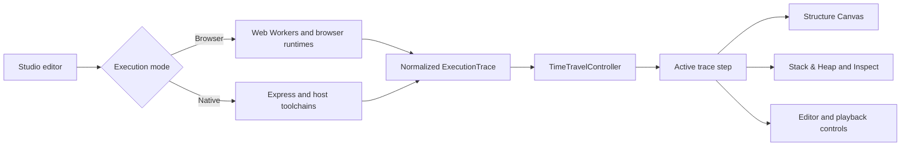

# ParallelX

ParallelX is the open-source repository for **Parallax**, a workbench for learning how programs execute. Write code, run a trace, and step through changes to variables, memory, and data structures.

The Studio supports JavaScript, TypeScript, Python, C, C++, Java, and C#. Browser Mode runs all seven languages in dedicated Web Workers. Java and C# use educational subsets in the browser, and TypeScript execution erases types without a static type check. Native Mode uses a local or self-hosted Express server with the required host toolchains. See the [language compatibility matrix](docs/reference/LANGUAGE_COMPATIBILITY.md) for runtime and tracing limits.

## Run locally

From your checkout, use Node.js 22.18+ on the 22.x line or Node.js 24.11+ with npm. For the full test suite used by CI, install Python 3 and a C compiler and put them on your PATH.

```sh
npm ci
npm run dev
```

Open [localhost:3000](http://localhost:3000). Browser Mode needs no native compiler installations, account, or API key. Copy `.env.example` to `.env` if you want to override defaults. For a frontend-only preview, run `npm run build` followed by `npm run preview`. See [development setup](docs/development/SETUP.md) and [deployment](docs/deployment/DEPLOYMENT.md) for details.

## What you can do

- **Studio** lets you run code, scrub backward or forward, and pause at breakpoints. The **Structure Canvas** automatically draws strings, variables, collections, and detected structures. Use **Configure visualizer** to choose a representation or bind an algorithm to specific variables. **Stack & Heap** and **Inspect** show stack frames, objects, pointers, or collections when the runtime captures them.
- **Learn** offers guided data structures and algorithms exercises with runnable examples. Open it from the app navigation.
- **Challenges** runs public sample checks and can request server-side verification when an evaluation server is available. Open it from the app navigation.
- **Settings → Workspace tools** lets you add Stack & Heap, Complexity, Console, and other tools to the default code-and-canvas view. Settings also lets you configure editor and playback defaults and export local preferences, saved work, and learning progress.

[Explore the feature map](docs/product/FEATURES.md).

## How it works



Auto Mode tells you which runtime it selected. The execution adapter returns the same trace shape for every runtime. Playback reads the captured trace, so moving to an earlier step does not rerun the program.

| Topic | Documentation |
| --- | --- |
| Architecture | [System overview](docs/architecture/SYSTEM_OVERVIEW.md), [execution architecture](docs/architecture/EXECUTION_ARCHITECTURE.md), [data flow](docs/architecture/DATA_FLOW.md) |
| Runtimes and trace data | [Browser execution](docs/architecture/BROWSER_EXECUTION.md), [native execution](docs/architecture/NATIVE_EXECUTION.md), [trace schema](docs/architecture/EXECUTION_TRACE.md), [memory model](docs/architecture/MEMORY_MODEL.md) |
| Development | [Setup](docs/development/SETUP.md), [workflow](docs/development/DEVELOPMENT_WORKFLOW.md), [testing](docs/development/TESTING.md), [adding a language](docs/development/ADDING_A_LANGUAGE.md) |
| Deployment and limits | [Deployment](docs/deployment/DEPLOYMENT.md), [environment configuration](docs/deployment/ENVIRONMENT_CONFIGURATION.md), [security boundaries](docs/reference/SECURITY_AND_SANDBOX_LIMITATIONS.md), [known limitations](docs/reference/KNOWN_LIMITATIONS.md) |

[Full documentation index](docs/README.md).

## Contributing

Read the [contributing guide](CONTRIBUTING.md), [code of conduct](CODE_OF_CONDUCT.md), and [support guide](SUPPORT.md). Report vulnerabilities privately using the [security policy](SECURITY.md).

```sh
npm run lint
npm run build
npm test
```

Build before testing so the production checks can inspect the generated client bundle.

## License

ParallelX is licensed under [Apache License 2.0](LICENSE). Third-party dependencies and assets are subject to their own license terms.
