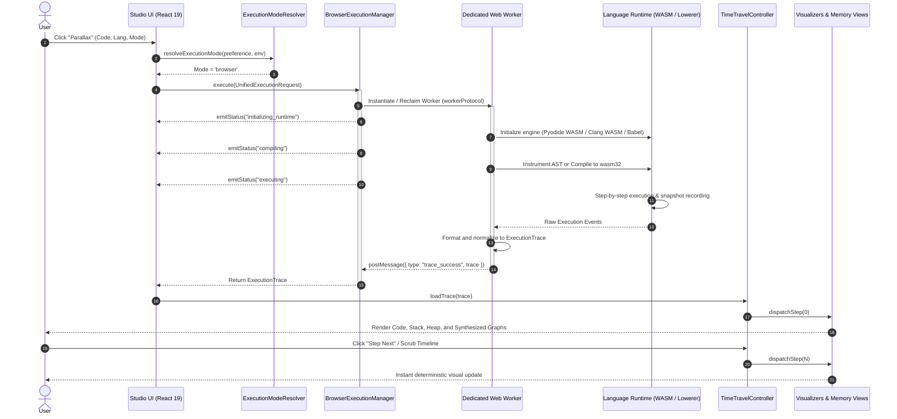

# Browser Execution Architecture

This document details the client-side browser execution subsystem, dedicated Web Worker lifecycles, WebAssembly compiler toolchains, AST subset lowerers, and worker communication protocols.

---

## 1. Browser Execution Manager (`BrowserExecutionManager`)

The `BrowserExecutionManager` (`src/core/execution/browserExecutionManager.ts`) coordinates all in-browser code execution.

### Responsibilities

- **Main Thread Protection**: User code parsing, AST manipulation, WASM compilation, and program execution are offloaded to dedicated Web Workers (`type: "module"`). The main UI thread never freezes.
- **Concurrency & Worker Pooling**: Bounded concurrency pool (serialized to 1 active worker for heavy WASM runtimes like Pyodide and Clang; up to 2 for lightweight JS/TS workers).
- **Hard Cancellation**: Immediate termination via `worker.terminate()` if execution exceeds the watchdog timeout (3,000ms default) or if the user clicks "Stop".
- **Progress Telemetry**: Streams lifecycle stage events (`initializing_runtime`, `compiling`, `executing`) and partial trace counts back to the UI.

---

## 2. Browser Execution Lifecycle



---

## 3. Worker Transport Protocol (`workerProtocol.ts`)

Communication between the main UI thread and Web Workers occurs over a typed `PostMessage` protocol:

### Main Thread -> Worker Messages

```typescript
export type MainToWorkerMessage =
  | { type: "execute"; payload: UnifiedExecutionRequest }
  | { type: "cancel"; executionId: string };
```

### Worker -> Main Thread Messages

```typescript
export type WorkerToMainMessage =
  | {
      type: "status";
      executionId: string;
      stage: ExecutionStage;
      progress?: number;
    }
  | { type: "trace_chunk"; executionId: string; events: TraceEvent[] }
  | { type: "trace_success"; executionId: string; trace: ExecutionTrace }
  | {
      type: "error";
      executionId: string;
      error: string;
      diagnostics?: Diagnostic[];
    };
```

---

## 4. Language-Specific Browser Implementations

### 4.1 JavaScript (ES2024) & TypeScript (5.4)

- **Worker**: `src/core/execution/workers/jsWorker.ts`
- **Engine**: `@babel/standalone` + `JsTraceRuntime` (`src/core/languages/jsExecutionCore.ts`).
- **Instrumentation**: AST visitor injects deterministic statement-level step trackers, loop iteration counters, and call stack observers.
- **TypeScript Handling**: Babel transforms TypeScript syntax via type erasure. Static `tsc` type checking is not performed in the browser.

### 4.2 Python (3.13 via Pyodide 0.29.5 WASM)

- **Worker**: `src/core/execution/workers/pythonWorker.ts`
- **Engine**: Self-hosted Pyodide WebAssembly running CPython 3.13.2.
- **Assets**: Self-hosted from `/pyodide/*` (~11.9 MB payload) and cached via the browser Cache API.
- **Tracing**: Injects `PYTHON_TRACER_SCRIPT` utilizing `sys.settrace` to record real local frames, global variables, and heap objects step by step.
- **Constraints**: Single concurrent instance cap (~200–350 MB RAM budget); recursion depth limited to 120 frames under WASM.

### 4.3 C17 (Clang/LLVM 22.1.0 WASM)

- **Worker**: `src/core/execution/workers/cWorker.ts`
- **Engine**: Self-hosted `@yowasp/clang` targeting `wasm32-wasip1`.
- **Assets**: Self-hosted Clang/LLVM + `wasm-ld` + `wasi-libc` bundle (`/c-toolchain/*`).
- **Memory Model**: Real 32-bit linear memory addresses (`0x00010040`). Pointers are genuine 32-bit offsets into WASM memory.
- **Safety**: Compiled with Clang UBSan trap instrumentation (`-fsanitize=null,bounds,integer-divide-by-zero -fsanitize-trap=all`) and bounded to 64 MiB WASM memory and 2,500 steps.

### 4.4 C++20 (Clang++/LLVM 22.1.0 + libc++ WASM)

- **Worker**: `src/core/execution/workers/cppWorker.ts`
- **Engine**: Self-hosted Clang++ with LLVM `libc++` targeting `wasm32-wasip1`.
- **Features**: Real C++20 STL containers (`std::vector`, `std::unordered_map`, `std::stack`, `std::queue`), smart pointers (`std::shared_ptr`, `std::unique_ptr`), RAII lifecycle tracking, and C++ exception unwinding via SjLj (`libsetjmp`).
- **Precompiled Headers**: Uses a cached C++20 STL precompiled header (`__dr_pch.hpp.pch`) to accelerate browser compile times.

### 4.5 Java (Educational Subset Transpiler)

- **Worker**: `src/core/execution/workers/javaWorker.ts`
- **Engine**: Java-to-JavaScript AST transpiler with emulated JVM runtime semantics (`javaExecutionCore.ts`).
- **Semantics**: Emulates 32-bit two's-complement arithmetic (`Math.imul`), 64-bit longs (`BigInt`), Java Collections (`ArrayList`, `LinkedList`, `HashMap`, `PriorityQueue`), and deterministic object identity hashes (`ClassName@N`).
- **Honest Boundary**: Does **not** execute OpenJDK bytecode in Browser Mode. Real javac + JVM execution is provided via Native Mode.

### 4.6 C# (Educational Subset Transpiler)

- **Worker**: `src/core/execution/workers/csharpWorker.ts`
- **Engine**: C#-to-JavaScript AST transpiler with emulated .NET CLR semantics (`csharpExecutionCore.ts`).
- **Semantics**: Emulates value types (structs, record structs, enums) copied by value vs reference types (classes, arrays, collections) referenced by ID (`ClassName@N`), method-syntax LINQ (`Where`, `Select`, `OrderBy`), and `IDisposable` tracking (`using`).
- **Honest Boundary**: Does **not** execute .NET 8 IL in Browser Mode. Real Roslyn + CoreCLR execution is provided via Native Mode.

---

## 5. Related Documentation

- [System Overview](SYSTEM_OVERVIEW.md)
- [Execution Architecture](EXECUTION_ARCHITECTURE.md)
- [Native Execution Architecture](NATIVE_EXECUTION.md)
- [Memory Model](MEMORY_MODEL.md)
- [Language Compatibility Reference](../reference/LANGUAGE_COMPATIBILITY.md)
