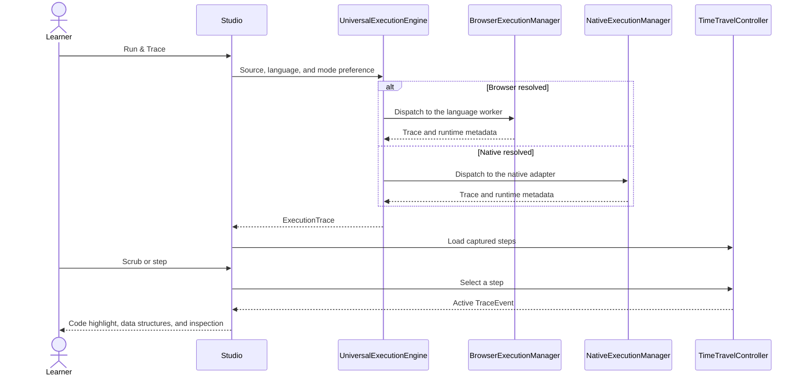

# From source code to playback

The Studio sends the selected language, code, and execution preference to the engine when you click **Run & Trace**. The engine resolves the mode, dispatches the run, and returns a normalized trace. Playback and visualization use the active step from that trace.

## Runtime dispatch

Explicit Browser and Native preferences stay with the selected mode. Auto chooses an available runtime and surfaces the resolution in the Studio. The browser manager starts a worker for the language adapter. In the app, the native manager forwards execution requests to Express, which coordinates host toolchains. See the [execution architecture](EXECUTION_ARCHITECTURE.md) for capability checks and failure handling.

## Recording and normalizing a run

Each adapter captures the source position, scopes, and memory or collection events its runtime supports. The result uses the canonical [trace schema](EXECUTION_TRACE.md), including execution metadata and available program output. Runtime guards and managers enforce budgets during execution. Their limits depend on the adapter and mode.

## Updating the Studio

The time-travel controller indexes captured events. Studio uses the event to highlight the source line and runs the DSA detector for the Structure Canvas. Stack & Heap and Inspect read recorded runtime state for the same step. Selecting another step or changing workspaces updates what you see from the existing trace.

A data structure can appear once the runtime records enough information to render it. The canvas can be empty at a function-entry step before a structure is created.

## Related documentation

- [System overview](SYSTEM_OVERVIEW.md)
- [Execution trace](EXECUTION_TRACE.md)
- [Memory model](MEMORY_MODEL.md)
- [Studio feature map](../product/FEATURES.md)
