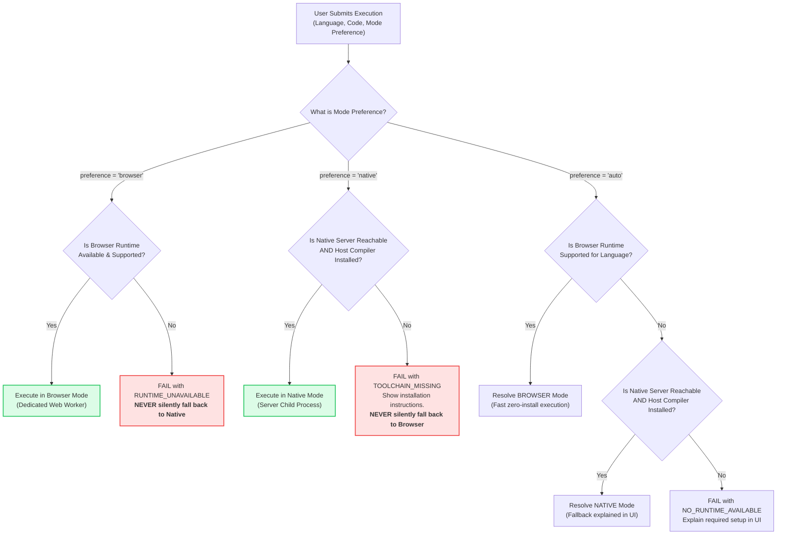
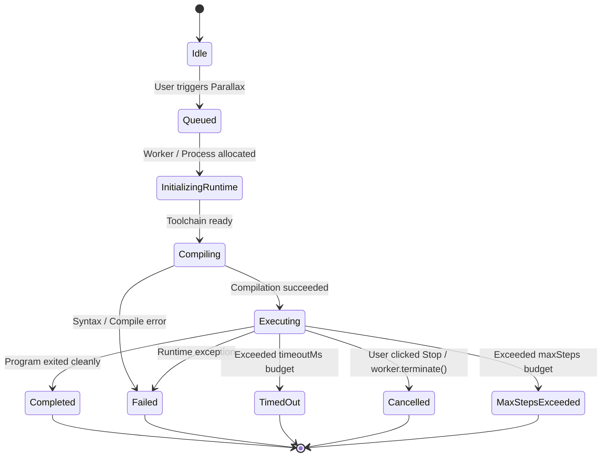
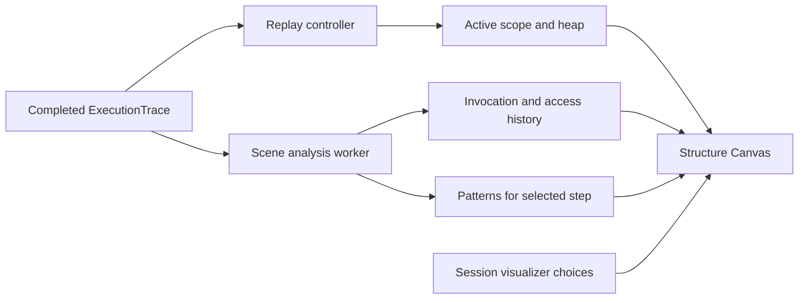

# Execution Architecture

This document specifies the dual-tier execution architecture powering Parallax, the deterministic execution mode resolution policy, and the execution lifecycle state transitions.

---

## 1. Dual Execution Model

Parallax provides two execution environments unified by the `UnifiedExecutionAdapter` contract (`src/core/execution/contracts.ts`):

```typescript
export interface UnifiedExecutionAdapter {
  readonly id: string;
  readonly language: LanguageId;
  readonly mode: ExecutionMode; // 'browser' | 'native'
  getCapabilities(): Promise<RuntimeCapabilityDescriptor>;
  execute(request: UnifiedExecutionRequest): Promise<ExecutionTrace>;
  cancel?(executionId: string): Promise<void>;
  dispose?(): Promise<void>;
}
```

### Architectural Comparison

| Dimension              | Browser Mode (Client-Side)                                                        | Native Mode (Server-Side)                                                             |
| ---------------------- | --------------------------------------------------------------------------------- | ------------------------------------------------------------------------------------- |
| **Host Process**       | Dedicated Web Worker (`type: "module"`)                                           | Host OS Child Process spawned by Node.js                                              |
| **Server Requirement** | **None** (100% static client-side)                                                | Requires `server.ts` active on host                                                   |
| **Toolchain Delivery** | On-demand WebAssembly (Pyodide, Clang WASM) or in-memory AST lowerers             | Uses pre-installed native binaries (`gcc`, `g++`, `javac`, `dotnet`, `python3`)       |
| **Address Model**      | 32-bit linear memory (`0x00010040`) for C/C++; symbolic IDs (`@obj_1`) for others | 64-bit OS virtual memory (`0x7ffc...`) for C/C++; runtime object graphs for others    |
| **Isolation Boundary** | Web Worker thread + WASM linear memory sandbox                                    | OS process sandboxing, isolated temp directory (`/tmp/dryrun_*`), timeout enforcement |
| **Cancellation**       | Cooperative flag + immediate hard `worker.terminate()`                            | Cooperative flag + immediate `SIGKILL` process tree termination                       |
| **Deployment Fit**     | Static CDNs (Vercel, Cloudflare Pages, Netlify, GitHub Pages)                     | Dedicated Linux VPS, Docker containers, local development machine                     |

---

## 2. Execution Mode Resolution (`executionModeResolver.ts`)

The execution mode resolver evaluates the user's mode preference (`'browser' | 'native' | 'auto'`), the active language, and available runtime capabilities.



### Why Silent Fallback is Strictly Prohibited

1. **Predictable Memory Addresses**:
   In C and C++, Browser Mode uses 32-bit WASM linear memory offsets (`0x00010040`), while Native Mode produces true 64-bit OS virtual pointers (`0x7ffc3a4f8920`). Silent fallback would cause pointer sizes and memory layouts to unpredictably mutate beneath the user.
2. **Honest Educational Contracts**:
   In Java and C#, Browser Mode runs educational AST lowerers, while Native Mode runs real OpenJDK 21 and .NET 8. Silently falling back between them would confuse learners regarding what language features and reflection mechanics are actually available.
3. **Reproducible Debugging**:
   Deterministic time-travel debugging requires that the same execution mode produces identical traces every time.

---

## 3. Execution Lifecycle State Transitions

Every execution request progresses deterministically through standardized lifecycle states:



### Lifecycle Stage Definitions

1. `idle`: No active execution; editor is awaiting user input.
2. `queued`: Request is queued in `BrowserExecutionManager` worker pool or `ExecutionCoordinator` concurrency queue.
3. `initializing_runtime`: Loading Web Worker script, Pyodide WASM runtime, or probing native compiler child process.
4. `compiling`: Running Clang WASM, Babel AST transformation, or host `gcc`/`javac`/`dotnet`.
5. `executing`: Running the instrumented program, recording statement steps, call frames, and heap mutations.
6. `completed`: Execution finished within resource budgets; complete `ExecutionTrace` dispatched to UI.
7. `timed_out`: Exceeded watchdog timeout (3,000ms in browser, 2,000–5,000ms native). Hard process killed.
8. `cancelled`: Aborted by user clicking "Stop" on the toolbar. Worker terminated via `worker.terminate()`.
9. `failed`: Execution failed due to syntax error, compilation diagnostic, or unhandled runtime exception.
10. `max_steps_exceeded`: Execution exceeded the maximum allowed step ceiling (2,500–3,000 in browser, 10,000–12,000 native).

---

## 4. Related Documentation

- [System Overview](SYSTEM_OVERVIEW.md)
- [Browser Execution Architecture](BROWSER_EXECUTION.md)
- [Native Execution Architecture](NATIVE_EXECUTION.md)
- [Language Compatibility Reference](../reference/LANGUAGE_COMPATIBILITY.md)
- [Security & Sandbox Limitations](../reference/SECURITY_AND_SANDBOX_LIMITATIONS.md)

## Visualization after execution



The analysis worker is replaced when Studio receives a new trace. Replaying a step or applying a view choice uses captured data. Optional event fields include indexed string reads, map/set operations, and verified indexed operands contributing to array writes. Heap objects can carry typed key/value entries. Call frames can include a function definition identity distinct from their invocation ID.
