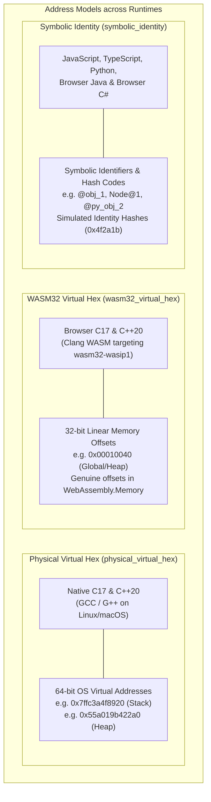
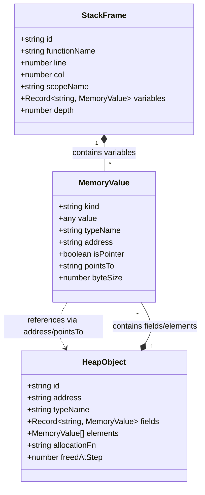

# Memory Model & Address Representation

This document details how Parallax represents variables, stack frames, dynamic heap allocations, and pointer addresses across supported languages and execution tiers.

---

## 1. Address Models (`AddressModelKind`)

Parallax enforces strict truthfulness in memory representation. The system uses three distinct address models:



### 1.1 Physical Virtual Hex (`physical_virtual_hex`)

- **Applies to**: Native C17 and Native C++20 execution.
- **Pointers**: Genuine 64-bit virtual memory addresses emitted by the host operating system kernel.
- **Semantics**: Real pointer arithmetic (`ptr + 1` increments by `sizeof(T)` bytes), real array decay, struct byte alignments, and true stack vs heap memory regions.

### 1.2 WASM32 Virtual Hex (`wasm32_virtual_hex`)

- **Applies to**: Browser Mode C17 and Browser Mode C++20 (Clang WASM).
- **Pointers**: Real 32-bit linear memory byte offsets into the WebAssembly `WebAssembly.Memory` buffer (e.g. `0x00010040`).
- **Semantics**: Real pointer arithmetic operating over WASM linear memory bytes.

### 1.3 Symbolic Identity (`symbolic_identity`)

- **Applies to**: JavaScript, TypeScript, Python, and Browser Mode Java / C#.
- **Pointers**: True hardware pointers do not exist in these languages. Object references are represented symbolically (e.g. `@obj_1`, `@py_obj_2`, `Node@1`, `List@3`).
- **The Memory Anti-Fabrication Rule**: Physical hex addresses (e.g. `0x7ffc1000`) are **never fabricated** for managed languages.

---

## 2. Stack Frame Architecture (`StackFrame`)

A `StackFrame` represents an active lexical scope on the call stack:

```typescript
export interface StackFrame {
  id: string; // e.g. "frame_0_main", "frame_1_factorial"
  functionName: string; // e.g. "binarySearch", "dfs", "<module>"
  line: number; // Current source line executing
  col: number; // Current column executing
  scopeName: string; // "local" | "global" | "block" | "static"
  variables: Record<string, MemoryValue>; // In-scope variables
  depth: number; // Call depth (1-indexed)
}
```



---

## 3. Dynamic Heap Graph (`HeapObject`)

Objects living on the heap are stored in the trace's `heap` map:

- `id`: Stable allocation ID (e.g. `heap@1`, `Node@2`).
- `address`: Virtual memory address or WASM linear offset.
- `typeName`: Concrete type (e.g. `std::vector<int>`, `ArrayList<String>`, `int[5]`).
- `fields`: Struct members or object properties (`Record<string, MemoryValue>`).
- `elements`: Indexed array items (`MemoryValue[]`).
- `allocationFn`: Allocator invoked (`malloc`, `calloc`, `new`, `new[]`, `make_shared`, `stack`).
- `freedAtStep`: Step index where memory was deallocated. If an execution step references an object where `freedAtStep <= currentStep`, the Memory Inspector highlights a **Use-After-Free** warning.

---

## 4. Related Documentation

- [System Overview](SYSTEM_OVERVIEW.md)
- [Execution Trace Schema](EXECUTION_TRACE.md)
- [Data Flow Architecture](DATA_FLOW.md)
- [Coding Standards](../development/CODING_STANDARDS.md)
