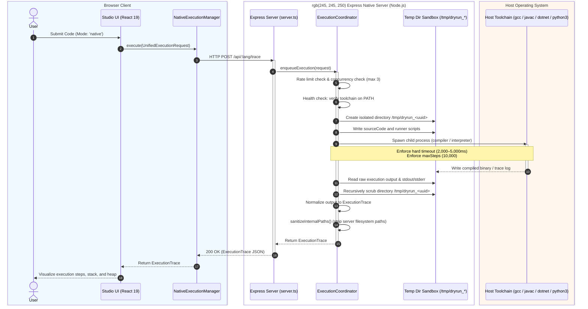

# Native Execution Architecture

This document describes the Native Execution Server (`server.ts` and `src/server/executionCoordinator.ts`), child process orchestration, compiler toolchains, execution bounds, and realistic security isolation.

---

## 1. Native Execution Server Overview

The Native Execution Server is an Express-based service (`server.ts`) that runs alongside Vite in development and serves the production build while coordinating real host compiler processes.

### Native Execution Endpoints

| Endpoint | Target Runtime / Toolchain | Typical Execution Method |
|---|---|---|
| `POST /api/javascript/trace` | Node.js V8 | Sandboxed Node script + AST tracer |
| `POST /api/typescript/trace` | Node.js V8 | Babel type erasure + Node script |
| `POST /api/python/trace` | Host CPython 3 (`python3 -I`) | Injected `sys.settrace` harness |
| `POST /api/c/trace` | Host GCC (`gcc -std=c17`) | Instrumented binary execution |
| `POST /api/cpp/trace` | Host G++ (`g++ -std=c++20`) | Instrumented binary execution |
| `POST /api/java/trace` | Host OpenJDK 21 (`javac` + `java`) | Java tracer agent / instrumented bytecode |
| `POST /api/csharp/trace` | Host .NET 8 SDK (`dotnet build` / `csc`) | Roslyn instrumented runner |
| `POST /api/challenges/evaluate`| Server-side Hidden Vault | Secret test case evaluation |
| `GET /api/ops/health` | Toolchain Discovery Probe | Reports installed compilers and versions |
| `GET /api/ops/metrics` | Real-Time Telemetry | Queue depths, active executions, average latency |

---

## 2. Native Execution Lifecycle

---

## 3. Process Orchestration & Bounded Concurrency

The `ExecutionCoordinator` (`src/server/executionCoordinator.ts`) coordinates compiler child processes with strict limits:

- **Bounded Concurrency**: Maximum 3 concurrent compiler child processes by default to prevent CPU thrashing.
- **Queue Limits**: Maximum 16 queued requests before rejecting incoming requests with HTTP 429 (Too Many Requests) or HTTP 503 (Service Unavailable).
- **IP Rate Limiting**: Sliding-window rate limiter per client IP address.
- **Dedicated Temp Directories**: Each run executes in a dedicated temporary directory (`/tmp/dryrun_<uuid>`) scrubbed immediately on exit via `rm -rf`.
- **Hard Timeout Caps**: Process execution is bounded by configurable timeouts (default 2,000–3,000ms, maximum 5,000ms). If a process exceeds this limit, the process tree is terminated immediately via `SIGKILL`.
- **Output Truncation**: Standard output and standard error streams are capped at 50,000 characters to prevent buffer exhaustion.
- **Error Path Sanitization**: All compiler errors, stack traces, and diagnostics pass through `sanitizeInternalPaths()` to strip local host filesystem paths (e.g. `/Users/username/...` or `/tmp/...`).

---

## 4. Sandbox Reality & Operational Security

> [!WARNING]
> **Host Process Isolation Limitations**:
> Node.js child processes running in temporary directories provide filesystem separation and timeout enforcement, but they do **not** constitute an impenetrable OS jail or VM-grade sandbox. Untrusted native C/C++ code can still perform system calls if hosted directly on bare metal.
>
> When hosting Native Mode in a multi-tenant public environment:
> 1. Run the server inside unprivileged container runtimes (such as **gVisor**, **Firecracker**, or **Docker** with dropped capabilities `--cap-drop=ALL`).
> 2. Mount `/tmp` as a size-constrained `tmpfs` with `noexec` options where appropriate.
> 3. Enforce OS-level resource limits using `cgroups` and `ulimit` (limiting memory, CPU share, and maximum open file descriptors).

---

## 5. Related Documentation

- [System Overview](SYSTEM_OVERVIEW.md)
- [Execution Architecture](EXECUTION_ARCHITECTURE.md)
- [Browser Execution Architecture](BROWSER_EXECUTION.md)
- [Self-Hosting Deployment Guide](../deployment/DEPLOYMENT.md)
- [Security & Sandbox Limitations](../reference/SECURITY_AND_SANDBOX_LIMITATIONS.md)
