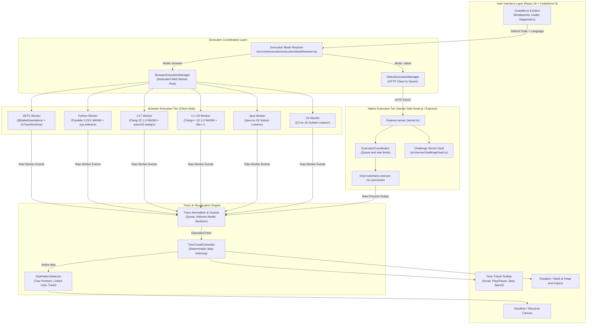

# System Overview Architecture

This document serves as the authoritative high-level architecture specification for **Parallax**. It describes the core system components, their responsibilities, operational boundaries, and architectural invariants.

---

## 1. Product Identity & Purpose

**Parallax** is an open-source, deterministic code execution visualizer, memory inspector, and interactive Data Structures & Algorithms (DSA) learning workbench.

Learners and engineers write standard source code across **7 supported languages**, run it step-by-step, inspect variable frames and dynamic heap graphs, navigate execution history forward and backward, and verify algorithmic solutions.

The Structure Canvas draws active-scope values directly from each captured step. A dedicated analysis worker indexes calls and observed accesses, and supplies DSA patterns for replay. Optional session choices refine the drawing. The runtime records values and memory relationships, and the Studio uses those observations to recognize data structures.

---

## 2. High-Level System Architecture

Parallax follows a decoupled architecture that cleanly separates interactive presentation, execution coordination, language-specific runtimes, and deterministic state visualization.

---

## 3. Core Component Responsibilities

| Component                     | Location                                        | Primary Responsibility                                                                                                                                   |
| ----------------------------- | ----------------------------------------------- | -------------------------------------------------------------------------------------------------------------------------------------------------------- |
| **Code Editor**               | `src/components/studio/CodeMirrorEditor.tsx`    | Syntax highlighting, line numbers, active step gutter marker, and user breakpoint management.                                                            |
| **Execution Mode Resolver**   | `src/core/execution/executionModeResolver.ts`   | Resolves `browser`, `native`, or `auto` execution preferences based on environment capabilities. Enforces no silent fallback.                            |
| **Browser Execution Manager** | `src/core/execution/browserExecutionManager.ts` | Manages dedicated Web Worker lifecycles, concurrency bounding, progress reporting, and hard termination via `worker.terminate()`.                        |
| **Native Execution Manager**  | `src/core/execution/nativeExecutionManager.ts`  | Dispatches execution requests to the local/self-hosted Express server and queries compiler availability.                                                 |
| **Native Server Coordinator** | `src/server/executionCoordinator.ts`            | Process queuing, rate limiting, dispatch to the selected runtime, and operational health reporting. Native subprocesses use per-run temporary directories and timeouts.                |
| **Unified Trace Model**       | `src/core/types.ts`                             | Canonical schema (`ExecutionTrace`, `TraceEvent`, `MemoryValue`) that normalizes all 7 languages into an identical data contract.                        |
| **Time Travel Controller**    | `src/core/replay/timeTravelController.ts`       | Deterministic $O(1)$ navigation across execution history (Next, Previous, Jump to Step, Scrub, Breakpoints).                                             |
| **DSA Pattern Detector**      | `src/core/detectors/dsaDetector.ts`             | Synthesizes high-level visual structures (Arrays, Linked Lists, Binary Trees, Graphs) by inspecting runtime heap allocations and variable relationships. |
| **Challenge Secret Vault**    | `src/server/challengeVault.ts`                  | Evaluates additional challenge cases and sanitizes results. Fixtures in the source tree are visible to anyone with repository access.                              |

---

## 4. Architectural Invariants to Preserve

Every developer and AI coding agent working on this repository must strictly adhere to the following invariants:

1. **Unified Execution Contract**:
   All language runtimes must implement `UnifiedExecutionAdapter` (`src/core/execution/contracts.ts`).
2. **Dedicated Web Worker Isolation**:
   Browser compilation and user code execution run inside dedicated module Web Workers.
3. **Strict Mode Separation (No Silent Fallback)**:
   - Explicit **Browser Mode** must fail honestly with `RUNTIME_UNAVAILABLE` if browser workers are blocked. It must **never** silently fall back to Native Mode.
   - Explicit **Native Mode** must fail honestly with toolchain installation guidance if host compilers are missing. It must **never** silently fall back to Browser Mode.
   - **Auto Mode** resolves the optimal mode deterministically and reports the reason transparently.
4. **Memory Anti-Fabrication Rule**:
   Never fabricate physical virtual hex addresses (e.g. `0x7ffc1000`) for garbage-collected or emulated languages (JavaScript, Python, Java, C#). Use symbolic identifiers (`@obj_1`) or simulated identity hashes (`0x<hash>`). Real pointer addresses are strictly reserved for native C/C++ execution. Browser WASM uses 32-bit linear memory offsets (`0x00010040`).
5. **Honest Runtime Capabilities**:
   Never misrepresent Java or C# browser runtimes as complete JVM or CLR implementations; they are educational subset lowerers. Never misrepresent Babel TypeScript type erasure as static `tsc` type checking.
6. **Static Deployment Independence**:
   Browser Mode must operate 100% client-side without requiring the Express backend.
7. **Challenge Secret Vault Isolation**:
   Hidden test cases in `src/server/challengeVault.ts` must never be imported into client code. Automated tests in `src/core/phase12Production.test.ts` enforce bundle hygiene.

---

## 5. Related Documentation

- [Execution Architecture](EXECUTION_ARCHITECTURE.md)
- [Browser Execution Architecture](BROWSER_EXECUTION.md)
- [Native Execution Architecture](NATIVE_EXECUTION.md)
- [Execution Trace Schema](EXECUTION_TRACE.md)
- [Memory Model](MEMORY_MODEL.md)
- [End-to-End Data Flow](DATA_FLOW.md)
- [Codebase Structure](CODEBASE_STRUCTURE.md)
