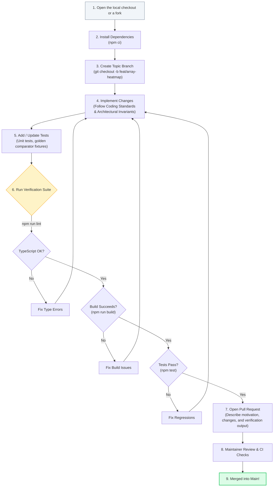

# Development & Contribution Workflow

This document details the contributor lifecycle, branch naming standards, commit conventions, visualizer creation, and debugging techniques for Parallax.

---

## 1. Contributor Workflow

Every contribution to Parallax progresses through a standardized lifecycle:



---

## 2. Conventions & Standards

### Branch Naming Conventions

- `feat/<short-description>`: New runtime features, language capabilities, or visualizers
- `fix/<short-description>`: Bug fixes, trace normalization corrections, or edge-case handling
- `docs/<short-description>`: Documentation additions, corrections, and Mermaid diagram updates
- `refactor/<short-description>`: Code maintenance without behavioral changes

### Commit Message Conventions

Follow Conventional Commits:

- `feat(studio): add binary tree force-directed layout`
- `fix(c-runtime): correct pointer offset calculation for double pointers`
- `docs(architecture): clarify wasm32 linear address representation`
- `test(golden): add nested loop fixture for Java subset lowerer`

---

## 3. Adding a Structural Visualizer

Visualizers translate normalized `TraceEvent` snapshots into interactive pedagogical representations:

### Step 1: Create the Component

Create your visualizer component in `src/components/studio/<VisualizerName>.tsx`:

```tsx
import React from "react";
import { TraceEvent, DsaPattern } from "../../core/types";

interface VisualizerProps {
  activeEvent: TraceEvent;
  allEvents: TraceEvent[];
  pattern?: DsaPattern;
}

export const MyVisualizer: React.FC<VisualizerProps> = ({
  activeEvent,
  allEvents,
  pattern,
}) => {
  // Pure rendering logic based strictly on activeEvent
  return (
    <div className="p-4 bg-white dark:bg-slate-900 rounded-lg">
      {/* Visual representation */}
    </div>
  );
};
```

### Step 2: Connect to Pattern Detector

If the visualizer is activated by automatic DSA detection, register detection rules in `src/core/detectors/dsaDetector.ts`:

- Inspect variable names, data types, and heap pointer graphs.
- Calculate confidence score ($0.0 - 1.0$) and classification tier (`Confirmed`, `Likely`, `Possible`).
- Synthesize `nodes`, `edges`, and `pointers`.

### Step 3: Register in Studio Coordinator

In `src/components/studio/DsaVisualizerView.tsx`, register the visualizer under the appropriate pattern tab or view selector.

### Step 4: Verify Determinism

Write a test in `src/core/visualization.test.ts` verifying that scrubbing backward to a previous step restores the exact visualizer state.

---

## 4. Debugging & Diagnostics

### 4.1 Debugging Browser Mode Execution

1. Open Chrome DevTools (`F12` / `Cmd+Opt+I`) and go to the **Console** tab.
2. Select the dedicated Web Worker thread in the thread dropdown (e.g. `jsWorker.ts`, `pythonWorker.ts`, `cWorker.ts`).
3. Trace inbound messages (`type: 'execute'`) and outbound responses (`type: 'trace_success'` or `'trace_chunk'`).
4. **Pyodide WASM Assets**: Verify that Pyodide assets are served from `/pyodide/*` with MIME type `application/wasm`.
5. **Clang WASM Assets**: Check the returned `compilerDiagnostics` array in the trace if C/C++ compilation fails.

### 4.2 Debugging Native Mode Execution

1. **Toolchain Health**: Probe compiler detection by running:
   ```bash
   curl http://localhost:3000/api/ops/health
   ```
2. **Server Logs**: In `npm run dev`, inspect server log lines displaying request duration, queue depth, and status. (User source code is never printed to logs).

---

## 5. Related Documentation

- [Development Setup](SETUP.md)
- [Testing Guide](TESTING.md)
- [Coding Standards](CODING_STANDARDS.md)
- [Adding a Language](ADDING_A_LANGUAGE.md)
