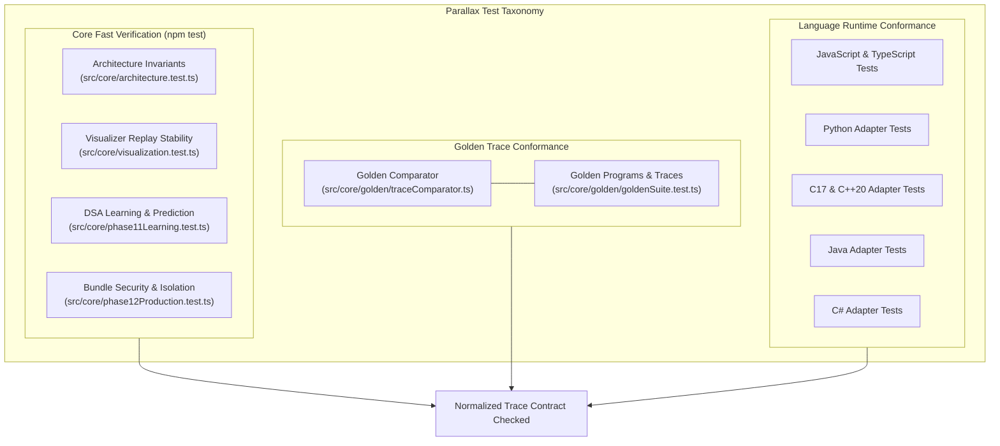

# Testing & Verification Guide

This document explains the test architecture, test suites, golden trace comparator, and verification standards for Parallax.

---

## 1. Test Architecture

Parallax contains modular test suites covering architecture invariants, runtime adapters, deterministic replay, visualizer stability, and production security isolation:



---

## 2. Running Test Suites

### Standard Core Test Suite

Build first so the core tests can check the generated browser bundle.

```bash
npm run build
npm test
```

This executes:

1. `architecture.test.ts`: Validates execution engines, address modeling, and resource bounds.
2. `visualization.test.ts`: Tests Programs A through N covering arrays, two-pointer swaps, nested loops, recursion stacks, and scrubbing regression.
3. `phase11Learning.test.ts`: Verifies prediction generation, event filtering, curriculum topics, and challenge verification.
4. `phase12Production.test.ts`: Asserts that hidden challenge test cases never leak into the compiled client bundle, verifies path sanitization, and checks rate limiting.

### Comprehensive Test Execution

To run all unit and integration test suites:

```bash
bun test
```

> [!NOTE]
> The core suite requires Python 3 and a C compiler. Additional runtime suites have their own toolchain requirements. For browser integration checks, use the running Studio to verify a trace, switch views mid-replay, and check both desktop and mobile layouts.

---

## 3. Golden Trace Comparator (`src/core/golden/traceComparator.ts`)

The golden test suite ensures that execution traces adhere to reference execution semantics:

- **Nondeterminism Stripping**: The comparator automatically normalizes timestamps and execution timing before comparing traces against reference fixtures.
- **Semantic Assertions**:
  - Variable assignments, types, and values match across each step.
  - Call stack depths and return values are identical.
  - Memory allocations, deallocations, and pointer targets match reference invariants.

---

## 4. Writing New Tests

When adding a test:

1. **Locate Tests Appropriately**: Place unit tests adjacent to the component or engine under test (e.g. `feature.test.ts`).
2. **Enforce Determinism**: Never rely on `Math.random()`, `Date.now()`, or external network calls inside test assertions.
3. **Cover Both Success and Failure Modes**: Always test both happy paths (valid code compiles and produces correct steps) and failure paths (syntax errors, infinite loop watchdog timeout, division by zero halts cleanly).
4. **Never Weaken Assertions**: Never delete tests or loosen tolerance thresholds to bypass failing checks.

---

## 5. Related Documentation

- [Development Setup](SETUP.md)
- [Development Workflow](DEVELOPMENT_WORKFLOW.md)
- [Coding Standards](CODING_STANDARDS.md)
- [Codebase Structure](../architecture/CODEBASE_STRUCTURE.md)
