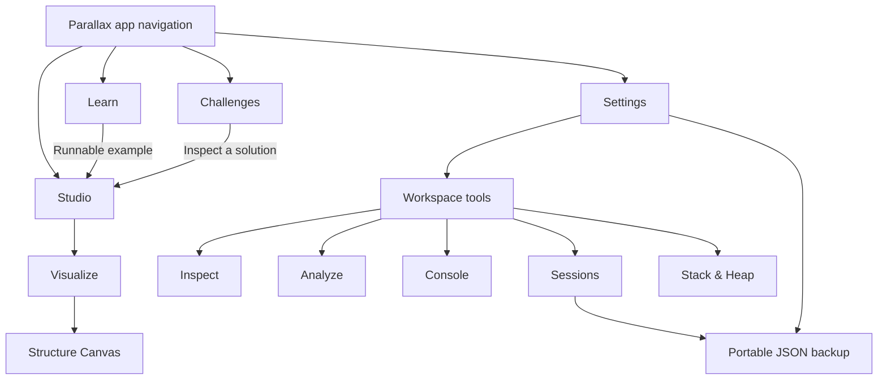

# ParallelX features

Parallax provides an execution Studio, guided lessons, coding challenges, and local workspace settings. Learn and Challenges are discoverable from the app navigation.

## Studio

The left pane contains the CodeMirror editor, language and template selectors, and breakpoint controls. The execution workspace uses a shared playback timeline. You can step in either direction, jump between breakpoints, scrub to a frame, and adjust playback speed.

Studio opens with the editor, Structure Canvas, playback controls, and a short explanation of the current step. Open **Settings → Workspace tools** to hide the explanation or add the tools below. For example, enable Complexity to study input growth, or Stack & Heap to follow recursive calls. Returning from Settings preserves your draft and replay position.

| Workspace | What it shows |
| --- | --- |
| **Visualize → Structure Canvas** | Arrays, lists, maps, graphs, trees, and other data structures when recognized in the trace. Array cells show their indices and highlight recorded reads, writes, and swaps. |
| **Visualize → Stack & Heap** | The selected step's call frames and heap objects. References can link to the corresponding object. The address model depends on the runtime. |
| **Inspect** | Variables, call stack, memory, patterns, loops, and conditions, plus runtime-specific views when available. |
| **Analyze** | Tools for comparing traces, measuring step growth, testing edge cases, and predicting execution behavior. |
| **Console and event history** | Program output and a filterable event list can be enabled individually. Execution errors appear directly in Studio. |
| **Sessions** | Saved code and controls for exporting or importing local work. Open saved sessions from the Studio actions menu at any time. |

### Configure the visualizer

Auto starts with the active function’s captured variables. Strings have indexed character rows, scalar values have named boxes, and maps preserve key types. Observed indices, operations, and calls add detail during replay. Expand **Outer scopes** to inspect a caller.

Use **Configure visualizer** above the canvas to select an algorithm and add choices for individual variables. For example, enter **Two pointers on s[i] and t[j]** or choose **Stack** for an array named `items`. Review the choices and press **Apply**. Other variables stay in Auto. A traversal can bind the current node, frontier, visited set, and custom link fields. Choose **Reset all to Auto** to clear the choices. Saved sessions include their visualizer configuration.

### Runtime-specific inspection

| Runtime | Additional Inspect views |
| --- | --- |
| C | Pointers, Structs, Lifecycle |
| C++ | Pointers & Ownership, Objects & Structs, STL & Iterators, Lifecycle |
| Java | Objects & References, Collections & Iterators, Exceptions |
| C# | Objects & Value Types, Collections & Iterators, Lifecycle |

These views show the information recorded by the selected runtime. In Browser Mode, C and C++ use 32-bit WebAssembly offsets. Java and C# traces use symbolic object identities. See the [memory model](../architecture/MEMORY_MODEL.md) and [language compatibility matrix](../reference/LANGUAGE_COMPATIBILITY.md).

## Learn

Lessons cover complexity, arrays and strings, two pointers and sliding windows, linked lists, trees and graphs, stacks and queues, and dynamic programming. Open a runnable example in Studio to compare the explanation with what the trace records. Progress is saved in the browser.

## Challenges

Choose a problem, write a solution, and run the public cases. A configured evaluation server can run additional server-side cases and return sanitized results. Browser-only deployments can run the public cases locally. Inspect your solution in Studio to follow its behavior step by step.

## Settings and portability

Set editor preferences, default language, replay speed, and an optional Native Execution Server URL. Use JSON backups to move preferences, saved sessions, and progress between browsers. See the [environment configuration](../deployment/ENVIRONMENT_CONFIGURATION.md) for deployment settings.
