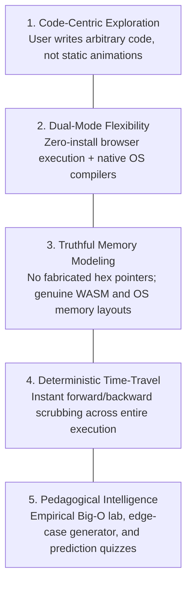

# Product Overview

> **See your program from every angle.**

This document describes the educational vision, product architecture, and user problems solved by **Parallax**.

---

## 1. Problem Statement

Computer science learners, software engineers, and educators frequently struggle to mentally model:

- How memory state mutates line-by-line during program execution.
- How pointers and references alias, decay, and mutate in the heap.
- Why recursive functions cause call stack growth, frame stacking, and unwinding.
- How abstract algorithms (e.g. Two Pointers, Sliding Window, BFS/DFS, In-Place Reversal) correspond to physical variable updates.

Existing developer tools generally fall into two extremes:

1. **Static / Hardcoded Animations**: Visually pleasing but completely inflexible; learners cannot test their own code, write custom edge cases, or debug arbitrary algorithms.
2. **Traditional Debuggers**: Extremely powerful but notoriously complex to configure, showing raw hex addresses and memory dumps without visual structural insights or intuitive time-travel scrubbing.

---

## 2. The Parallax Solution

Parallax bridges the gap between code and mental models:

1. **Write Arbitrary Code**: Learners write real code across **7 supported languages** directly in an interactive CodeMirror 6 editor.
2. **Execute Deterministically**: Real compilers, WebAssembly runtimes, and statement-level tracers produce step-by-step snapshots.
3. **Inspect Real State**: Observe active stack frames, heap objects, pointer arrows, and variable diffs.
4. **Time-Travel Scrubbing**: Step backward, step forward, jump to any step, or scrub the timeline slider with $O(1)$ random-access performance.
5. **Automatic DSA Deduction**: Synthesizes linked list diagrams, binary tree hierarchies, two-pointer array overlays, and call trees directly from runtime memory state without user configuration.

---

## 3. Core Product Pillars

---

## 4. Related Documentation

- [Platform Features](FEATURES.md)
- [System Overview](../architecture/SYSTEM_OVERVIEW.md)
- [Language Compatibility Reference](../reference/LANGUAGE_COMPATIBILITY.md)
