# Language Compatibility Reference

This document provides an honest, comprehensive evaluation of language support in Parallax across both **Browser Mode** and **Native Mode**.

---

## 1. Supported Language Architecture

Parallax supports 7 language environments. The diagram below illustrates their actual runtime execution paths:

```mermaid
flowchart TD
    subgraph Languages ["7 Supported Languages"]
        JS["JavaScript (ES2024)"]
        TS["TypeScript (5.4)"]
        PY["Python (3.13)"]
        C["C (C17)"]
        CPP["C++ (C++20)"]
        JAVA["Java (21 LTS)"]
        CS["C# (.NET 8)"]
    end

    subgraph BrowserRuntimes ["Browser Mode Execution Tiers (Dedicated Web Workers)"]
        direction TB
        subgraph RealBrowser ["Real Browser Runtimes (WASM & JS Engine)"]
            B_JS["@babel/standalone + JsTraceRuntime<br/>(Full ES2024 statement tracking)"]
            B_TS["Babel TypeScript Type Erasure<br/>(No static type checking in browser)"]
            B_PY["Pyodide 0.29.5 WebAssembly<br/>(Real CPython 3.13.2 interpreter + sys.settrace)"]
            B_C["Clang/LLVM 22.1.0 WASM (wasm32-wasip1)<br/>(Real 32-bit linear memory pointers)"]
            B_CPP["Clang++ 22.1.0 WASM + libc++<br/>(Real C++20 STL, RAII, wasm32)"]
        end

        subgraph PedagogicalSubsets ["Pedagogical Subset Transpilers (AST Lowerers)"]
            B_JAVA["Java-to-JS Subset Lowerer<br/>(Emulated 32-bit int, Collections, Object IDs)<br/><b>NOT a full JVM</b>"]
            B_CS["C#-to-JS Subset Lowerer<br/>(Struct value vs Class ref semantics, LINQ)<br/><b>NOT a full .NET CLR</b>"]
        end
    end

    subgraph NativeRuntimes ["Native Mode Execution Tiers (Host OS Compilers)"]
        direction TB
        N_JS["Node.js V8 (ES2024)"]
        N_TS["Node.js V8 (Type-erased)"]
        N_PY["Host CPython 3.10+ (python3 -I + sys.settrace)"]
        N_C["Host GCC (gcc -std=c17) + 64-bit OS virtual pointers"]
        N_CPP["Host G++ (g++ -std=c++20) + 64-bit OS virtual pointers"]
        N_JAVA["Host OpenJDK 21 LTS (javac + java)"]
        N_CS["Host .NET 8 SDK (dotnet build / csc)"]
    end

    %% Mappings
    JS --> B_JS & N_JS
    TS --> B_TS & N_TS
    PY --> B_PY & N_PY
    C --> B_C & N_C
    CPP --> B_CPP & N_CPP
    JAVA --> B_JAVA & N_JAVA
    CS --> B_CS & N_CS
```

---

## 2. High-Level Compatibility Matrix

| Language        | Identifier   | Browser Mode Runtime                   | Native Mode Toolchain                     | Browser Fidelity                     | Native Fidelity                    |
| --------------- | ------------ | -------------------------------------- | ----------------------------------------- | ------------------------------------ | ---------------------------------- |
| **JavaScript**  | `javascript` | `@babel/standalone` + `JsTraceRuntime` | Node.js (V8)                              | Complete (ES2024)                    | Complete (ES2024)                  |
| **TypeScript**  | `typescript` | Babel TS Type Erasure                  | Node.js (V8)                              | Type-erased (no static `tsc` errors) | Type-erased                        |
| **Python**      | `python`     | Pyodide 0.29.5 (CPython 3.13.2 WASM)   | Host `python3` (3.10+) via `sys.settrace` | Full CPython 3.13 stdlib subset      | Complete CPython 3.10+             |
| **C (C17)**     | `c`          | Clang 22.1.0 WASM (`wasm32-wasip1`)    | Host `gcc` (C17) + instrumentation        | Real 32-bit linear memory pointers   | Real 64-bit physical OS pointers   |
| **C++ (C++20)** | `cpp`        | Clang++ 22.1.0 + libc++ WASM           | Host `g++` (C++20) + instrumentation      | Real C++20 STL, RAII, wasm32         | Real 64-bit OS pointers & full STL |
| **Java**        | `java`       | Java-to-JS Subset Lowerer              | Host OpenJDK 21 (`javac` + `java`)        | Educational subset transpiler        | Complete OpenJDK 21 LTS            |
| **C#**          | `csharp`     | C#-to-JS Subset Lowerer                | Host .NET 8 (`dotnet` / `csc`)            | Educational subset transpiler        | Complete .NET 8 C# 12              |
| **Go**          | `go`         | _None_                                 | _None_                                    | Reserved identifier                  | Reserved identifier                |

---

## 3. In-Depth Language Details

### 3.1 JavaScript (ES2024) & TypeScript (5.4)

- **Browser Execution**: Statement-level tracing via Babel AST transformation. Tracks variable scopes, loop iteration counters, and call stack depths.
- **TypeScript Handling**: Babel strips TypeScript type annotations via type erasure. Syntactic errors are caught, but static semantic type-checking is not performed in the browser.
- **Async Code**: Async functions and generator functions are skipped during step tracing to maintain deterministic sequential timelines.

### 3.2 Python (CPython 3.13)

- **Browser Mode**: Executes CPython 3.13.2 inside WebAssembly via Pyodide. Pre-loads common DSA modules: `math`, `heapq`, `collections`, `bisect`, `itertools`, `functools`, `typing`, `dataclasses`, `enum`, `random`, `string`.
- **Browser Limitations**: OS filesystem operations (`open`, `os`, `pathlib`) and network sockets (`socket`, `requests`, `urllib`) are disabled by policy. Recursion depth is capped at 120 frames.
- **Native Mode**: Executes `python3 -I` in a temporary directory with `sys.settrace`, capturing genuine CPython call frames, global dictionaries, and object references.

### 3.3 C (C17) & C++ (C++20)

- **Browser Mode**: Real compilation via Clang 22.1.0 targeting WebAssembly (`wasm32-wasip1`). Includes real pointer arithmetic, `malloc`/`free`, C++20 STL containers (`std::vector`, `std::unordered_map`, `std::stack`, `std::queue`, `std::string`), smart pointers (`std::shared_ptr`, `std::unique_ptr`), and RAII destructors.
- **Address Model**: Pointers reflect real 32-bit linear memory byte offsets (`0x00010040`).
- **Browser Limitations**: Multi-threading (`pthread.h`, `<thread>`), networking (`<sys/socket.h>`), and filesystem access (`<fstream>`) are disabled. Single-file compilation only.
- **Native Mode**: Compiles via local `gcc` or `g++` with address tracking. Emits true 64-bit OS virtual pointers (`0x7ffc...` / `0x55a0...`).

### 3.4 Java (Java 21 LTS)

- **Browser Mode**: Transpiles tested educational subsets of Java to JavaScript inside a dedicated Web Worker. Faithfully models 32-bit integer arithmetic, records, classes, polymorphism, and collections (`ArrayList`, `LinkedList`, `HashMap`, `PriorityQueue`).
- **Honest Boundary**: **Does not execute OpenJDK bytecode in Browser Mode.** Complex reflection, dynamic class loading, multithreading, and stream pipelines are unsupported in the browser.
- **Native Mode**: Executes real `javac` and `java` OpenJDK 21 on the server with complete standard library support.

### 3.5 C# (.NET 8 C# 12)

- **Browser Mode**: Transpiles tested educational subsets of C# to JavaScript inside a dedicated Web Worker. Faithfully models value types (structs, record structs, enums) copied by value vs reference types (classes, arrays, collections) referenced by ID (`ClassName@N`), method-syntax LINQ (`Where`, `Select`, `OrderBy`), and `using` statements.
- **Honest Boundary**: **Does not execute the .NET CLR or Roslyn in Browser Mode.**
- **Native Mode**: Executes real `dotnet build` / `csc` and CoreCLR on the server with complete .NET 8 support.

---

## 4. Structure Canvas coverage

The canvas reads a selected trace step in either execution mode. A basic drawing needs captured values. An operation highlight also needs evidence such as an indexed access, collection operation, reference edge, call, or return. The following probes exercised the capture and drawing paths together.

| Language | Browser probe | Native probe | Operation detail |
| --- | --- | --- | --- |
| JavaScript | Map with distinct numeric and string keys | Same map | Indexed string reads, map/set methods, array changes and direct indexed dependencies |
| TypeScript | Typed Map | Same map | Shares the JS instrumentation after type erasure |
| Python | Dictionary with distinct integer and string keys | Same dictionary | String subscripts use Python code-point indexing. Lists, tuples, sets, and dictionary entries use captured snapshots |
| C17 | Array with three integer cells | Same array | Indexed and pointer operations where the instrumentor emits them. User-built structures require captured fields and references |
| C++20 | Vector with three integer cells | Same vector | Uses recorded STL elements, entries, logical endpoints, and available array and lifecycle operations |
| Java | Integer array in the educational browser subset | Requires a host JDK. Native probe unavailable on the verification host | Uses recorded collection metadata and array operations |
| C# | Integer array in the educational browser subset | Requires a host .NET SDK. Native probe unavailable on the verification host | Uses recorded collection metadata and array operations |

Tree and graph layouts use captured references or explicitly selected adjacency representations. Recursive layouts use invocation history. Detailed BFS/DFS frontier transitions and direct DP write dependencies are currently captured most fully on the JavaScript/TypeScript path. Other adapters can draw a table or frontier from its captured contents even when they cannot identify the exact operation. Older traces can omit these optional observations.

## 5. Related Documentation

- [System Overview](../architecture/SYSTEM_OVERVIEW.md)
- [Execution Architecture](../architecture/EXECUTION_ARCHITECTURE.md)
- [Memory Model](../architecture/MEMORY_MODEL.md)
- [Known Limitations](KNOWN_LIMITATIONS.md)
